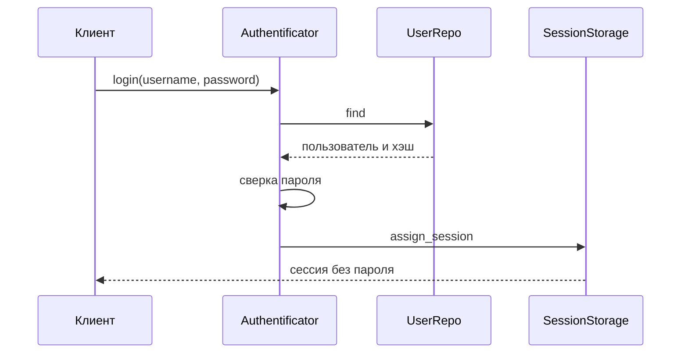

## Описание

`pyauth` — библиотека входа для сервисов на pyioc. `Authentificator` регистрирует пользователя, проверяет пароль (Argon2 или прямое сравнение), выдаёт сессию через `SessionStorage` и закрывает одну или все сессии. Пользователей читает `UserRepo`; HTTP-контроллер оборачивает login и logout в действия MVC. Своей базы в пакете нет: репозиторий и хранилище сессий подставляет сервис.

## Процедуры БД

Своих процедур базы данных нет: пользователи и сессии остаются за реализацией `UserRepo` и `SessionStorage` в сервисе.

## Схема работы

## Сценарии

### Вход

1. Сервис вызывает `Authentificator.login` с именем и паролем. HTTP-контроллер делает тот же вызов из действия login.
2. `UserRepo.find` возвращает пользователя и хэш. Репозиторий подставляет сервис: своей базы в пакете нет.
3. Пользователя нет — вход заканчивается ошибкой.
4. Пароль сверяется через Argon2 или прямым сравнением.
5. Пароль не совпал — ошибка, сессия не создаётся.
6. `SessionStorage.assign_session` записывает сессию.
7. Вызывающему возвращается сессия без пароля.

### Регистрация

1. Сервис вызывает `Authentificator.register` с пользователем.
2. `UserRepo.find` проверяет, есть ли такое имя.
3. Пользователь уже есть и вызов не идемпотентный — ошибка.
4. Пользователь уже есть и вызов идемпотентный — берётся существующая запись. Иначе `UserRepo.put` сохраняет нового.
5. `SessionStorage.assign_session` выдаёт сессию.

### Закрытие сессии

1. Сервис вызывает `logout` с одной сессией или `logout_all`.
2. `SessionStorage` закрывает эту сессию или все сразу.
3. HTTP-контроллер оборачивает logout в действие MVC так же, как login.

Authorization beans for pyioc-projects